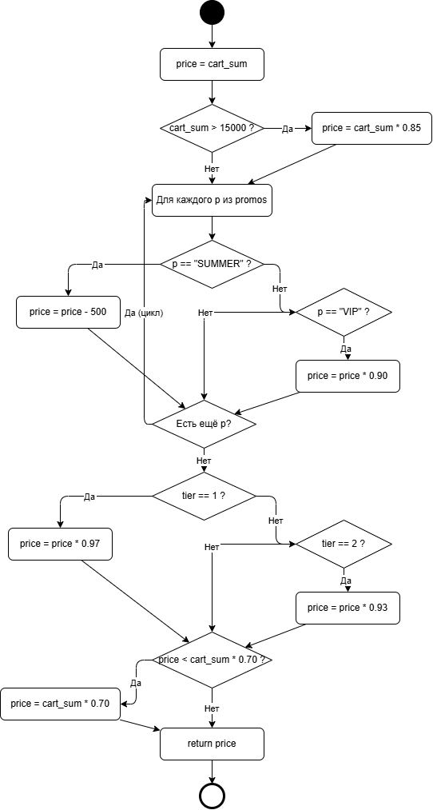

# Итоговый аналитический отчет (Лабораторная работа №1)

## 1. Резюме (Executive Summary)
В рамках работы спроектирован процесс разработки микросервиса «Расчет корзины и скидок»: выбран PostgreSQL на основе взвешенной матрицы (4.55 против 3.65 у MongoDB), настроены ветки, защита `develop`, CI через GitHub Actions с flake8, построена UML-диаграмма деятельности и подготовлен план code-review.

## 2. Сравнительный анализ технологий

### 2.1. Матрица принятия решений
| Критерий | Вес | PostgreSQL | MongoDB | PG (взвеш.) | Mongo (взвеш.) |
|---|---|---|---|---|---|
| ACID-транзакции | 0.35 | 5 | 3 | 1.75 | 1.05 |
| Гибкость схемы | 0.15 | 3 | 5 | 0.45 | 0.75 |
| Производительность чтения | 0.25 | 5 | 4 | 1.25 | 1.00 |
| Стоимость владения | 0.15 | 4 | 3 | 0.60 | 0.45 |
| Экосистема | 0.10 | 5 | 4 | 0.50 | 0.40 |
| **Итого** | **1.0** | | | **4.55** | **3.65** |

### 2.2. Расчет и обоснование выбора
Формула: `Оценка = Σ (Вес_i × Балл_i)`.
PostgreSQL: 0.35·5 + 0.15·3 + 0.25·5 + 0.15·4 + 0.10·5 = **4.55**.
MongoDB: 0.35·3 + 0.15·5 + 0.25·4 + 0.15·3 + 0.10·4 = **3.65**.
**Победитель:** PostgreSQL. Для финансовых транзакций и баллов ACID и строгая схема важнее гибкости документов; JSONB покрывает потребность в полуструктурированных данных без потери транзакций.

## 3. Архитектура и контроль версий
### 3.1. Настройка репозитория
Модель ветвления: `main` → `develop` → `feature/*`. Ссылка: https://github.com/RaiLKow/lab1-comprehensive-Rakov.
### 3.2. Контроль доступа
- http://portal.unn.ru/bitrix/services/main/ajax.php?action=disk.api.file.download&SITE_ID=s1&humanRE=1&fileId=5642314&exact=N&fileName=image%20%286%29.png.
- `CODEOWNERS`: @RaiLKow.

## 4. Инструментальный контроль качества
### 4.1. Настройка CI/CD
Ссылка: https://github.com/RaiLKow/lab1-comprehensive-Rakov/blob/feature/qa-gates/.github/workflows/qa.yml.
### 4.2. Работа Quality Gate
- http://portal.unn.ru/bitrix/services/main/ajax.php?action=disk.api.file.download&SITE_ID=s1&humanRE=1&fileId=5642277&exact=N&fileName=image%20%285%29.png.
- Исправление: удалён импорт, строка укорочена. Статус сменился на зелёный.

## 5. Обратное проектирование и планирование ревью
### 5.1. Анализ алгоритма

**Выявленные Code Smells:**
- Магические числа (`15000`, `0.85`, `500`, `0.90`, `0.97`, `0.93`, `0.70`).
- Отсутствие валидации входных параметров.
- Смешение ответственности: базовая скидка, промокоды и уровень лояльности в одной функции.

### 5.2. План code-review
https://github.com/RaiLKow/lab1-comprehensive-Rakov/pull/5.
Ключевые критерии: отсутствие магических чисел, валидация входа, покрытие > 80%.
Эскалация: тимлид команды лояльности в течение 1 рабочего дня.

## 6. Заключение
Настроенные процессы (защита `develop`, обязательный PR, CI-гейт flake8, план ревью) снижают риск внесения дефектов: ошибки стиля и неиспользуемые импорты отсекаются до слияния, а ревью фокусируется на бизнес-логике и защите от фрода.
